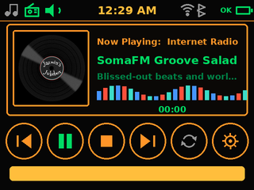

# Jazmin's JukeBox ♪

A standalone, self-contained digital music system for the **Raspberry Pi Zero 2 W**: local MP3/WAV/FLAC playback, internet radio, a retro jukebox interface on a 2-inch touchscreen, and a full phone web interface — with **no dependence on Volumio, Spotify, or any cloud service**. Anyone can install it, fork it, and make their own version.



## What you get

| Part | Role |
|---|---|
| **Jukebox touchscreen UI** | Landscape 320x240 app drawn directly on the SPI display: splash with the spinning vinyl GIF, player screen (status bar, now-playing card with album art or the GIF, equaliser, 6 round buttons, progress bar), and a settings screen with source selection |
| **Music on the screen's own SD card** | The TF slot on the back of the 2-inch display becomes /mnt/screen-sd via a custom device-tree overlay — MP3s live there, not on the Pi's card |
| **Mopidy** music server | Plays local files and internet radio streams, runs as a system service |
| **Iris web UI** | Full phone/PC interface for search, playlists, queue, and radio browsing at `http://jazmin.local:6680/iris` |
| **jukebox-music Samba share** | Drag-and-drop music upload from any phone or PC on the local network; guest access, no password |
| **IQaudio DigiAMP+ support** | Amp output configured automatically, speakers connected directly to the Pi |

The whole system is offline-first: with no internet, local music keeps playing and the touchscreen keeps working — only internet radio needs a connection. No BBC stations anywhere — the presets are international stations (SomaFM, Rock Antenne, Radio Paradise, KEXP).

## Network security

The phone Iris interface (Mopidy port 6680) and the music Samba share are available to devices on the local network without authentication; the Samba share allows guest uploads. Use only on a trusted, password-protected home network. Do not forward Mopidy or Samba ports from your router to the internet, and do not put the JukeBox on an untrusted guest/public network. The touchscreen reports the Raspberry Pi's current undervoltage warning (`OK`/`LOW`), not battery voltage/current or state of charge; use your separate battery volt/amp meter for those readings. A Pi undervoltage warning can also indicate a power, wiring, or load problem.

## Hardware this was built for

- Raspberry Pi Zero 2 W
- IQaudio DigiAMP+ (TAS5756M) with 12–24 V DC supply (your 12 V battery or AC/DC transformer)
- Pi Hut 2" Capacitive Touch IPS LCD (240x320, ST7789T3 + CST816D)
- 2 x 15 W 4-ohm speakers
- MicroSD card (16 GB+ recommended)

Full wiring table: [docs/HARDWARE.md](docs/HARDWARE.md)

## Quick start (30 minutes)

### 1. Flash Raspberry Pi OS Lite

1. Install [Raspberry Pi Imager](https://www.raspberrypi.com/software/) on your computer.
2. Choose **Raspberry Pi OS Lite (64-bit)** — the Trixie release, no desktop.
3. Click the gear/next button and set:
   - hostname: `jazmin`
   - enable SSH
   - set username `pi` + a password you'll remember
   - your Wi-Fi name and password
4. Flash the card, put it in the Pi Zero 2 W, and boot (the DigiAMP+ must be powered from its own 12 V supply — the Pi is powered through it. Do not also power the Pi through its USB input).

### 2. Copy this project to the Pi

From your computer, in this folder:

```bash
scp -r jazmins-jukebox pi@jazmin.local:~
```

(or use `scp -r . pi@jazmin.local:jukebox-setup` from inside the folder, or a USB stick)

### 3. Run the installer

SSH in and run it:

```bash
ssh pi@jazmin.local
cd ~/jazmins-jukebox
sudo bash install.sh
```

The installer is **idempotent** — you can run it again any time to repair or update. It will:

1. Install Mopidy (from Debian Trixie's own repos) plus Iris, Local and TuneIn extensions
2. Install the jukebox UI to `/opt/jukebox` and set it to start on boot
3. Enable SPI/I2C and configure the DigiAMP+ audio output
4. Set up the `jukebox-music` network share for uploads
5. Set the hostname to `jazmin` (skip with `--keep-hostname`)

Then reboot:

```bash
sudo reboot
```

After the reboot the screen shows the jukebox, and the phone interface is at **`http://jazmin.local:6680/iris`** (or `http://<pi-ip>:6680/iris`).

## Using it

### Boot sequence

The vinyl GIF plays on an amber splash for 3 seconds when the device is turned on, then the player screen appears (tap to skip the splash).

### The touchscreen (landscape)

- **Player screen**: status bar (source icons, clock, Wi-Fi, and the Pi's current power undervoltage status), now-playing card — album art when a track has it, the spinning vinyl GIF when it doesn't — track info, live equaliser, and six round buttons: previous, play/pause, stop, next, shuffle, settings. Progress bar and time at the bottom.
- **Settings screen**: icon grid (Music = play the screen SD's MP3s shuffled, Radio = internet radio, Mute, WiFi/BT/Clock/Battery info, Power = safe shutdown, Back) plus the station list — tap a station to play it, tap **MP3 files** to play your music. Swipe up/down on the list scrolls it.
- **Gestures on the player screen**: swipe left/right = next/previous track, swipe up/down = volume (with popup), double-tap = play/pause.
- The screen dims after 60 seconds of no touch; tap to wake.

### The phone interface (Iris)

Open `http://jazmin.local:6680/iris` on any phone/PC on the same Wi-Fi. You get search, queue, playlists, local library browsing, and TuneIn radio browsing.

### Adding music

MP3/WAV/FLAC files go on the **SD card in the screen** (FAT32). Fill it from any computer, insert, then `sudo jukebox-scan`. You can also drop files into the Samba share `\\jazmin.local\jukebox-music`, which lands on the Pi's own card.

### Managing radio stations

```bash
sudo jukebox-station list
sudo jukebox-station add 'Station Name' 'https://stream.url' A5 'genre'
sudo jukebox-station remove A3
sudo systemctl restart jazmin-jukebox
```

The station list on the settings screen updates from `/etc/jukebox/radio_presets.json` — edit that file directly or use the command.

## Making your own version

Everything is plain files you can edit:

| What | Where |
|---|---|
| Jukebox name on screen | `/etc/jukebox/jukebox.json` → `"name"` |
| Colours, dimming, rotation | `/etc/jukebox/jukebox.json` |
| Screen layout, buttons, animations | `/opt/jukebox/jukebox.py` |
| Display driver (pins) | `/opt/jukebox/display.py` + `jukebox.json` |
| Radio presets | `/etc/jukebox/radio_presets.json` |
| Music folders | `/etc/mopidy/mopidy.conf` |
| UI source code | `jukebox/` in this repo (Python, ~700 lines, no framework) |

Details and ideas: [docs/CUSTOMIZING.md](docs/CUSTOMIZING.md)

## Giving it to others ("flash and go")

Two options:

1. **Clone your configured card** (easiest): after setting one Pi up exactly how you want, clone the card to an image file (`sudo dd if=/dev/sdX of=jazmin.img bs=4M status=progress` then compress), and anyone can flash that image with Raspberry Pi Imager ("Use custom"). Remember to change the Wi-Fi credentials first (see docs).
2. **Build a clean image automatically**: `bash scripts/make-image.sh` (experimental; needs Docker, 30–60+ min). It prompts for the `pi` account password and produces an image with the screen SD slot, UI assets, and services configured. Keep the image and password private; change the password before sharing an image.

## Troubleshooting

- **No sound** — check `sudo aplay -l` shows the IQaudio card; check the DigiAMP+ has its own 12 V supply; check the amp mute overlay in `/boot/firmware/config.txt`.
- **Screen blank** — check wiring (see hardware doc), check `ls /dev/spidev0.0` exists; view logs with `journalctl -u jazmin-jukebox -f`.
- **Touch not working** — check `sudo i2cdetect -y 1` shows `15` at address 0x15.
- **Iris not loading** — check `systemctl status mopidy` and `journalctl -u mopidy -n 50`.
- **Everything else** — the installer can simply be re-run: `sudo bash install.sh`.

More detail: [docs/HARDWARE.md](docs/HARDWARE.md) · [docs/CUSTOMIZING.md](docs/CUSTOMIZING.md)

## Software stack

- Raspberry Pi OS Lite 64-bit (Debian 13 "Trixie")
- Mopidy 3.4 (Debian package) + Mopidy-Iris 3.70, Mopidy-Local 3.3, Mopidy-TuneIn 1.1 (pinned for Mopidy 3.x)
- Python 3 + Pillow + numpy, spidev, smbus2 — no X11/Wayland, the UI owns the framebuffer
- Samba for the upload share, systemd services for everything

Project structure:

```
jazmins-jukebox/
├── install.sh              one-shot installer (run on the Pi)
├── jukebox/                the touchscreen app (Python)
│   ├── jukebox.py          main app: splash / player / settings screens
│   ├── albumart.py         embedded + folder album art (GIF fallback)
│   ├── assets/JJukebox.gif the spinning vinyl intro animation
│   ├── display.py          ST7789 SPI display driver (landscape)
│   ├── touch.py            CST816D I2C touch driver
│   └── mopidy_client.py    JSON-RPC client for Mopidy
├── overlays/jazmin-sd.dts  device-tree overlay: screen's SD card slot
├── radio/                  config + radio presets (international, no BBC)
├── etc/                    mopidy.conf, systemd unit, samba share
├── scripts/                scan / station / image builder
├── sim/                    off-Pi UI preview (renders screenshots)
└── docs/                   hardware + customizing guides
```

## License & credits

The Jazmin's JukeBox project software and documentation are licensed under the [MIT License](LICENSE).

Bundled fonts are third-party works and are not covered by the project's MIT license. Righteous and Press Start 2P are distributed under the SIL Open Font License; see [fonts/OFL.txt](fonts/OFL.txt). DejaVu Sans is distributed under the Bitstream Vera license; see [fonts/DejaVu-LICENSE.txt](fonts/DejaVu-LICENSE.txt). Mopidy, Iris, Raspberry Pi OS, and other dependencies remain under their respective licenses and are installed from their normal sources.
